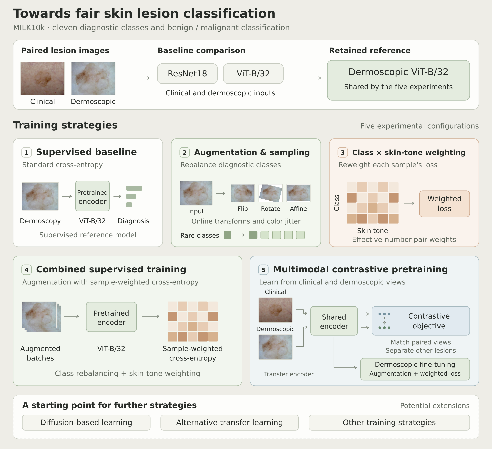
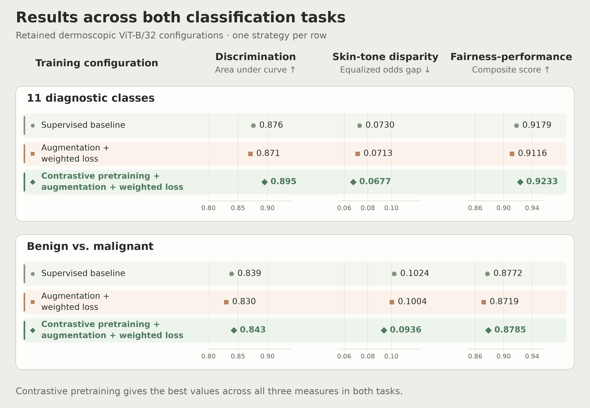

# Towards Fair and Inclusive Skin Lesion Classification Systems

Practical work developed for the bachelor's thesis **Towards Fair and Inclusive Skin Lesion Classification Systems**, using **MILK10k**. The study compares how model architecture, image modality and training strategy affect predictive performance, recognition of minority diagnostic classes and demographic fairness.

The experiments cover supervised baseline selection, interventions on the training distribution and loss function, and multimodal self-supervised representation learning. The repository brings these experiments into a common implementation that can also serve as a starting point for evaluating further strategies.

## Study overview

MILK10k contains 5,240 lesions with paired clinical and dermoscopic images, diagnostic labels and demographic metadata. The initial experiments compare **ResNet18 and ViT-B/32** on both image modalities. The retained reference for the strategy comparison is **dermoscopic ViT-B/32**.

All five training configurations are evaluated in two task formulations: **11 diagnostic classes** and **binary benign/malignant classification**. Multimodal pretraining uses both views of each lesion; downstream fine-tuning and classification use dermoscopic images.

## Training strategies

### 1. Supervised baseline

Pretrained backbones with a task-specific classification head, optimized with standard cross-entropy. The initial architecture and modality comparison establishes the reference configuration for the subsequent interventions. This baseline also supplies the common downstream model used to compare supervised rebalancing with multimodal pretraining.

### 2. Online augmentation and class-aware sampling

Horizontal and vertical flips, small rotations, affine scaling and shear, and moderate color jitter. Minority diagnostic classes receive additional augmented views through a class-dependent repeat factor, with exponent 0.5 and a maximum of six repetitions. A weighted sampler assigns probabilities proportional to inverse square-root class frequency.

This configuration changes exposure to diagnostic classes during training. Demographic attributes do not determine the sampling weights.

### 3. Class × skin-tone weighted loss

Sample-weighted cross-entropy with weights computed for each diagnosis and skin-tone combination. Effective-number reweighting accounts for the frequency of each pair, with normalization across observed valid pairs.

The retained settings use **β = 0.999** for 11-class classification and **β = 0.99** for the binary task. This intervention acts on the contribution of individual samples to the training objective.

### 4. Combined supervised training

Online augmentation, class-aware repetition and weighted sampling combined with the class × skin-tone loss. This configuration applies the data and objective interventions together, using the same dermoscopic backbone as the baseline.

The combined experiment provides the supervised reference for assessing the additional contribution of multimodal contrastive pretraining.

### 5. Multimodal contrastive pretraining

Clinical and dermoscopic images of the same lesion form positive pairs; other lesions in the batch supply negatives. A shared encoder and projection head are trained with a symmetric, bidirectional NT-Xent objective at temperature **0.10**.

The projection head is discarded after pretraining. The learned encoder then initializes the dermoscopic classifier, which is fine-tuned with augmentation, class-aware sampling and the weighted loss from the combined supervised experiment.

## Main results

The figure compares the retained baseline, combined supervised configuration and multimodal pretraining configuration. Exact values are available in [CSV format](assets/results.csv).

- Augmentation improved recognition of several minority classes, including dermatofibroma, vascular lesions and other benign proliferations. Its effect on the overall fairness-performance score was uneven.
- Combined supervised training slightly reduced the skin-tone gap while lowering discrimination and the composite score relative to the baseline.
- Multimodal contrastive pretraining followed by combined fine-tuning achieved the best values across the three displayed measures in both tasks. Gains in discrimination and the composite score were larger in the 11-class setting.

The evaluation also includes class-level precision, recall and F1, together with demographic fairness measures. Metric definitions, checkpoint selection and implementation details are documented in the [reproduction notes](docs/reproduction.md).

## A starting point for further strategies

The repository separates dataset interfaces, backbone construction, training strategies and evaluation. Shared training and reporting code, together with explicit configurations for both tasks, provides a common basis for comparing additional approaches against the retained experiments.

Potential extensions include **diffusion-based learning**, **alternative transfer learning protocols** and other augmentation, sampling, representation or loss strategies. The existing models already start from pretrained weights; further transfer learning experiments could vary the initialization, frozen layers or fine-tuning schedule. These directions are proposed extensions to the practical work presented here.

## Repository and reproducibility

| Location | Contents |
| --- | --- |
| [`configs/`](configs/) | Final hyperparameters for each strategy and task |
| [`src/milk10k/`](src/milk10k/) | Dataset processing, models, training and evaluation |
| [`scripts/`](scripts/) | Experiment entrypoints and dataset construction |
| [`notebooks/`](notebooks/) | Original execution notebooks and exploratory analysis |
| [Reproduction notes](docs/reproduction.md) | Environment setup, execution commands and output conventions |

The notebooks preserve the original experimental workflow; the modules and configurations contain its refactored implementation. Raw data, processed datasets, model checkpoints and generated experiment outputs are excluded from version control.

MILK study team. *MILK10k*. ISIC Archive, 2025. [Dataset DOI](https://doi.org/10.34970/648456) · [Dataset descriptor, Tschandl et al., 2026](https://doi.org/10.1016/j.jid.2025.06.1594).

Code: [MIT](LICENSE). Dataset photographs: [CC BY-NC 4.0](https://creativecommons.org/licenses/by-nc/4.0/), MILK study team. [Figure sources and photograph provenance](assets/README.md).
